# MoonShelf — Tienda de manga

Marketplace de mangas creado como proyecto final de Desafío Latam. Incluye una interfaz web para explorar un catálogo, consultar productos y gestionar el carrito, junto con un backend en desarrollo.

## Tabla de Contenidos

- [MoonShelf — Tienda de manga](#moonshelf--tienda-de-manga)
- [Tabla de Contenidos](#tabla-de-contenidos)
- [Funcionalidades](#funcionalidades)
- [Demo](#demo-frontend)
- [Vistas de la Aplicación](#vistas-de-la-aplicación)
- [Tecnologías y dependencias](#tecnologías-y-dependencias)
- [Requisitos](#requisitos)
- [Instalación y ejecución](#instalación-y-ejecución)
- [Pruebas y validaciones](#pruebas-y-validaciones)
- [Documentación del proyecto](#documentación-del-proyecto)
- [Estado de la Licencia](#estado-de-la-licencia)

## Funcionalidades

- Inicio y catálogo con búsqueda, filtros por género y ordenamiento.
- Vista de detalle de productos.
- Carrito de compras.
- Vistas de inicio de sesión, registro, perfil y órdenes.
- Diseño adaptable con React.

> El catálogo del frontend utiliza datos locales a modo de demo. La API aún está en una etapa de desarrollo inicial y no está implementada.

> Para la sesión de usuario no hay validaciones respecto al usuario de prueba. Puedes introducir cualquier correo y contraseña (8 o más caracteres) válidos para iniciar sesión.

## Demo (frontend)

### [**> Visita la demo aquí <**](https://proyecto-final-manga-store.vercel.app/)

## Vistas de la aplicación

### Home

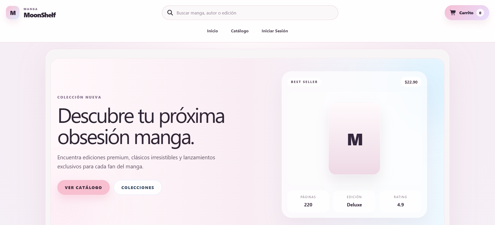
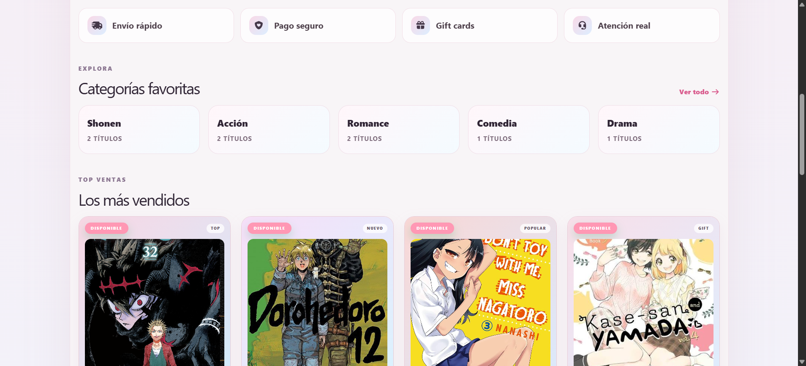
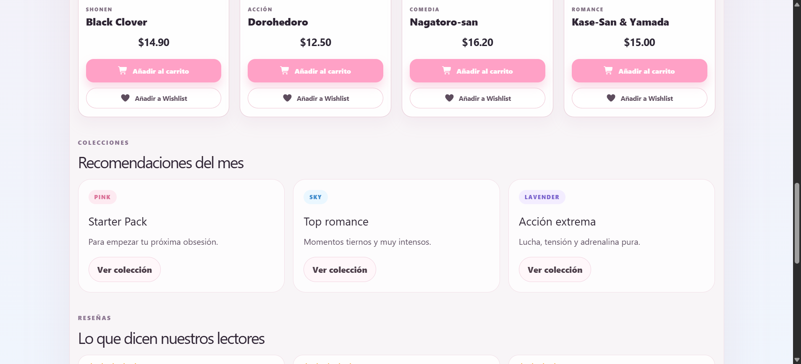
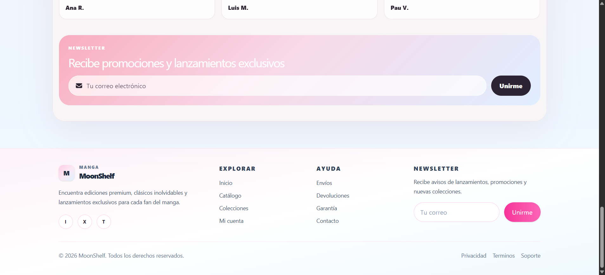

### Catalogo, Detalle de Producto y Barra de Búsqueda

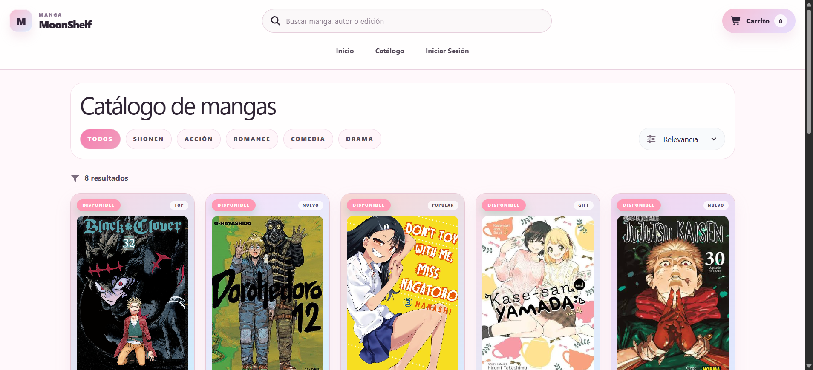
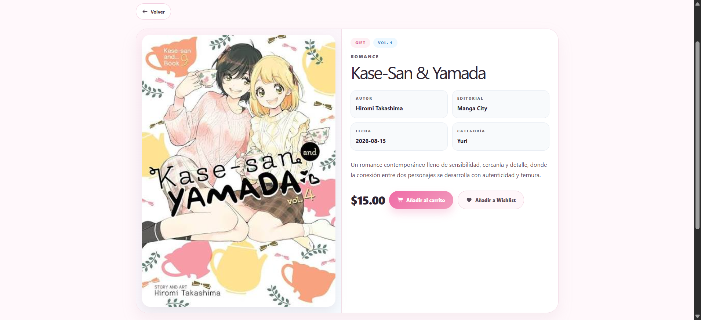
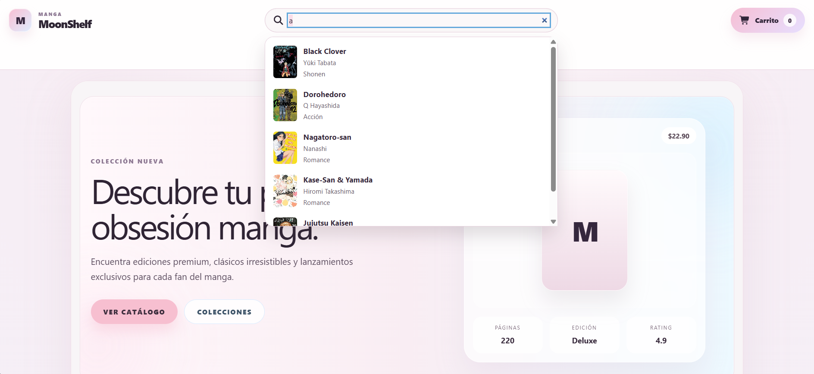

### Cart, Checkout y Ordenes de Compra

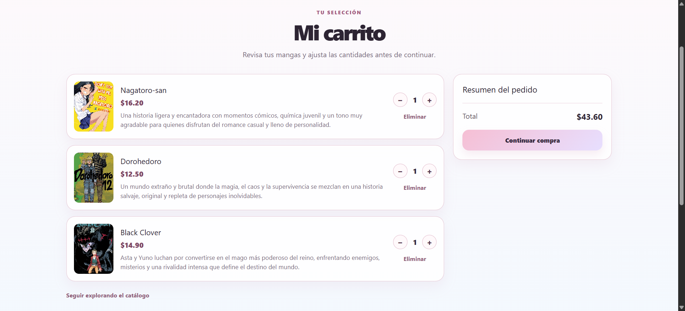
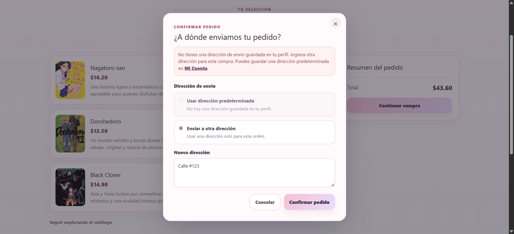
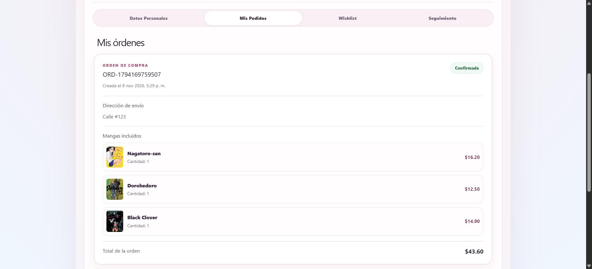
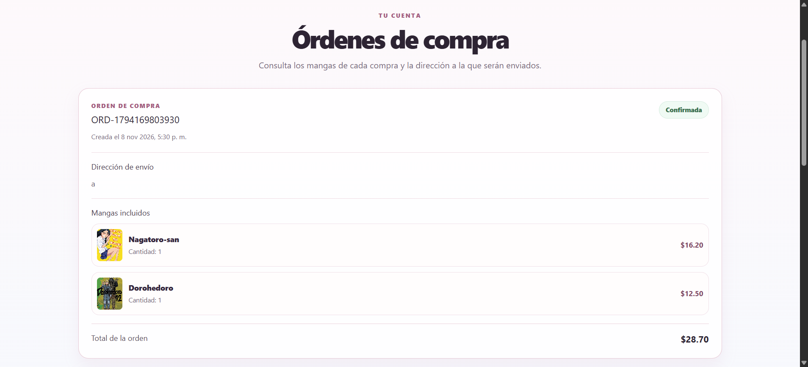

### Login, Register, Perfil y Wishlist

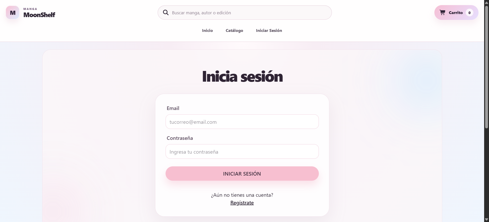
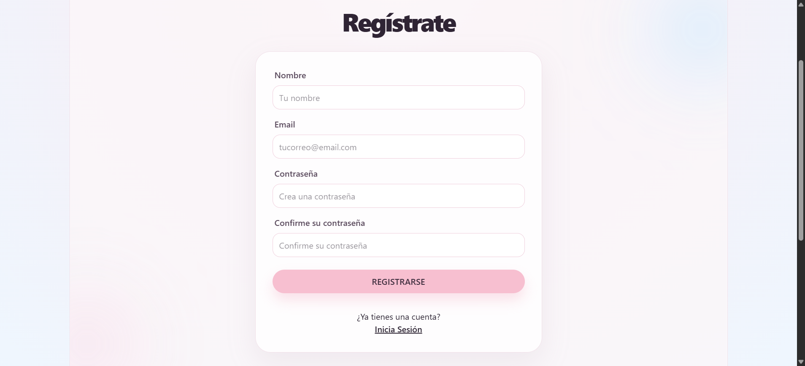
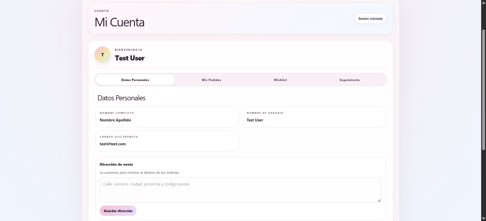
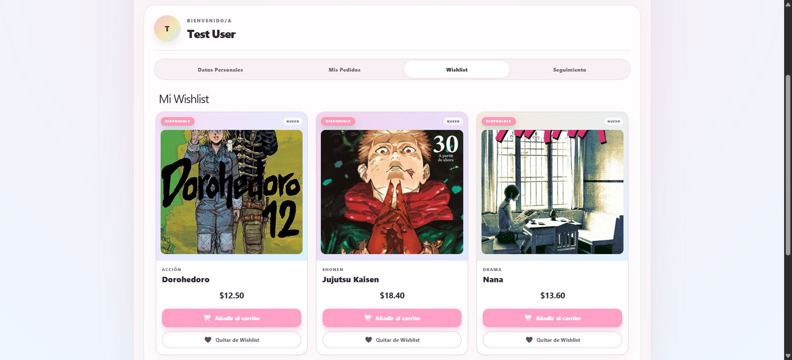

## Tecnologías y dependencias

- **Frontend:**
    - React + Vite
    - React Router
    - Tailwind CSS
    - Axios
    - Zod
    - JWT Decode
    - Font Awesome

- **Backend:**
    - Node.js
    - Express
    - PostgreSQL (`pg` y `pg-format`)
    - JWT
    - Argon2
    - Zod
    - CORS
    - DotEnv

- **Pruebas del frontend:**
    - Vitest

- **Pruebas del backend:** 
    - Jest
    - Supertest

## Requisitos

Tener instalada la versión más reciente de los siguientes programas:

- Node.js
- npm
- PostgreSQL

## Instalación y ejecución

Instala las dependencias de cada aplicación desde su propio directorio:

```bash
cd backend
npm install
```

En otra terminal, instala las del frontend:

```bash
cd frontend
npm install
```

### PostgreSQL

Usaremos `postgres` como usuario para configurar la base de datos, deberás ingresar su contraseña. También puedes usar otro usuario si así lo prefieres. Para esta sección, abre una terminal en la raíz del proyecto y sigue los pasos a continuación.

Crea la base de datos:

```PowerShell
createdb -U postgres moonshelf
```

Crea las relaciones de la base de datos ejecutando [`schema.sql`](./backend/src/database/schema.sql):

```PowerShell
psql -U postgres -d moonshelf -v ON_ERROR_STOP=1 -1 -f ./backend/src/database/schema.sql
```

Inserta datos de prueba a la base de datos ejecutando [`mock-data.sql`](./backend/src/database/mock-data.sql):

```PowerShell
psql -U postgres -d moonshelf -v ON_ERROR_STOP=1 -1 -f ./backend/src/database/mock-data.sql
```

> - Puedes ver ejemplos de inserción en [`insertion-example.sql`](./backend/src/database/insertion-example.sql)
> - También puedes usar ejemplos de selección en [`select-utilities.sql`](./backend/src/database/select-utilities.sql)
> - Se utiliza `SET client_encoding = 'UTF8';` al inicio de cada script para normalizar el formato de los datos insertados desde de la terminal de manera simple.
> - Recuerda que ejecutar [`schema.sql`](./backend/src/database/schema.sql) reinicia las relaciones, deberías ejecutarlo una única vez y repetir su ejecución solo para limpieza, no lo hagas si quieres persistir datos ingresados posteriormente.

### Backend

Crea `backend/.env` con la configuración correspondiente a tu entorno:

```env
PORT=5000
JWT_SECRET=reemplaza-por-un-secreto-local
PGHOST=localhost
PGPORT=5432
PGDATABASE=moonshelf
PGUSER=postgres
PGPASSWORD=postgres
```

> Recomendamos crear un usuario dedicado (ejemplo: moonshelf) con una contraseña segura y con los permisos mínimos necesarios solo para a esta base de datos y sus tablas, así disminuyes las brechas de seguridad.

Inicia el servidor desde `backend/`:

```bash
npm run dev
```

La API estará disponible en `http://localhost:5000`. Puedes comprobar su estado en `http://localhost:5000/`.

### Frontend

Crea `frontend/.env` y configura la URL de la API:

```env
VITE_API_URL=http://localhost:5000
```

Inicia Vite desde `frontend/`:

```bash
npm run dev
```

Vite mostrará en la terminal la dirección local de la aplicación, por defecto `http://localhost:5173`.

## Pruebas y validaciones

Para ejecutar las pruebas del backend:

```bash
cd backend
npm test
```

Para compilar y revisar el frontend:

```bash
cd frontend
npm run build
npm run lint
```

## Documentación del proyecto

- [Diseño de la base de datos](./docs/database-schema.jpg)
- [Contrato de datos de la API](./docs/5_Contrato_Datos_API.md)
- [Diseño de interfaz](./docs/1_Diseño_Interfaz_Gráfica.pdf)
- [Navegación y vistas](./docs/2_Navegación%20_Vistas.png)
- [Listado de dependencias](./docs/3_Listado_Dependencias.md)

## Estado de la Licencia

Proyecto académico en desarrollo. No se ha definido una licencia para el repositorio.
