# MoonShelf — Tienda de mangas

Marketplace de mangas creado como proyecto final de Desafío Latam. Incluye una interfaz web para explorar:
- Catálogo
- Consultar productos
- Consultar wishlist
- Gestionar órdenes de compra
- Gestionar carrito
- Iniciar sesión y registrarse
- Consultar perfil

Junto con un backend que permite:
- Autenticación de usuarios
- Gestión de usuarios 
- Consulta de catálogo de mangas
- Gestión de carrito
- Consultar categorías de mangas
- Gestionar wishlist por usuario
- Gestionar órdenes de compra por usuario

## Tabla de Contenidos

- [MoonShelf — Tienda de mangas](#moonshelf--tienda-de-mangas)
- [Tabla de Contenidos](#tabla-de-contenidos)
- [Funcionalidades](#funcionalidades)
- [Visita el Despliegue](#despliegue-cliente-frontend)<!-- - [Vistas de la Aplicación](#vistas-de-la-aplicación) -->
- [Tecnologías y Dependencias](#tecnologías-y-dependencias)
- [Requisitos](#requisitos)
- [Instalación y ejecución](#instalación-y-ejecución)
    - [PostgreSQL](#postgresql)
    - [Backend](#backend)
    - [Frontend](#frontend)
    - [Descarga del proyecto e instalación de dependencias](#descarga-del-proyecto-e-instalación-de-dependencias)
- [Pruebas y validaciones](#pruebas-y-validaciones)
- [Documentación del proyecto](#documentación-del-proyecto)
- [Estado de la Licencia](#estado-de-la-licencia)

## Funcionalidades

- Inicio y catálogo con búsqueda, filtros por género y ordenamiento.
- Vista de detalle de productos.
- Carrito de compras.
- Manejo de sesiones y usuarios, con registro e inicio de sesión.
- Perfil, órdenes y wishlist.
- Diseño adaptable con React.
- Logs personalizados en consola y archivos con información, consultas HTTP, y errores de la aplicación.
- Configuración personalizable de seguridad para el servidor con cors y helmet.

## Despliegue (cliente frontend)

### [**> Visita el despliegue aquí <**](https://moonshelf-kappa.vercel.app/)

<!-- ## Vistas de la aplicación

### Home

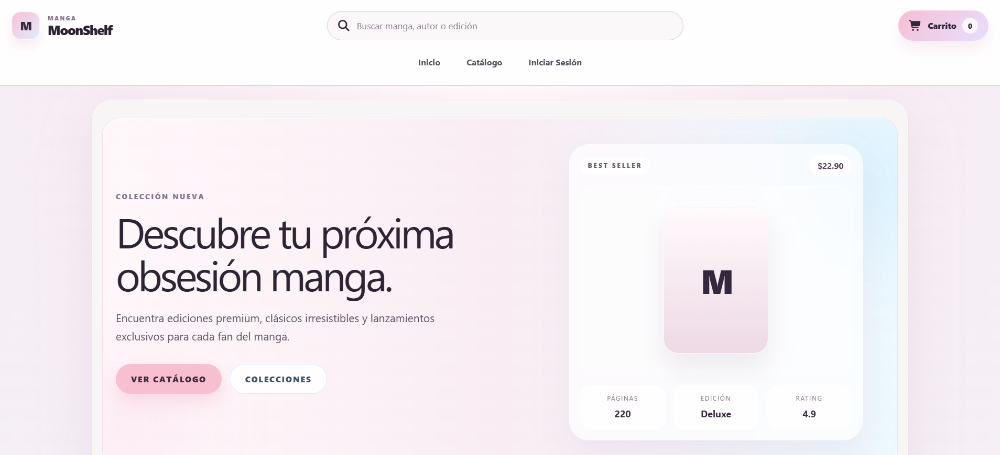
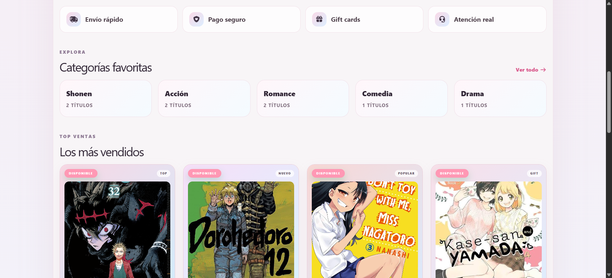
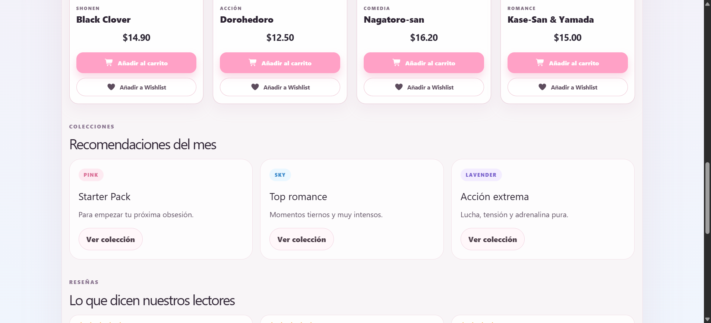
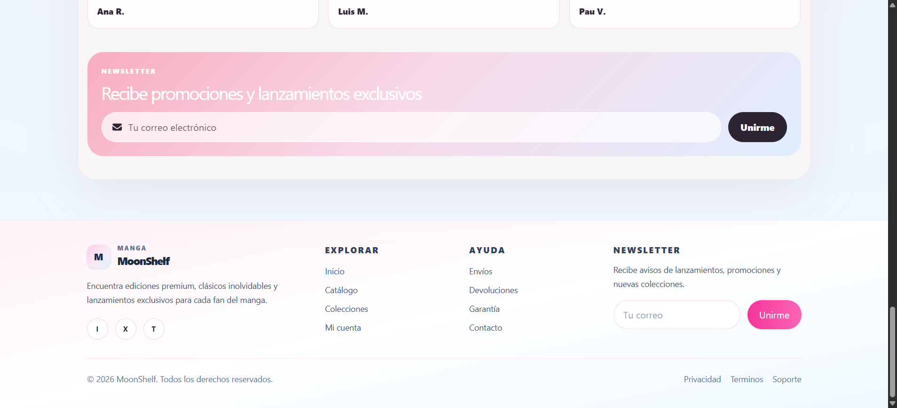

### Catalogo, Detalle de Producto y Barra de Búsqueda

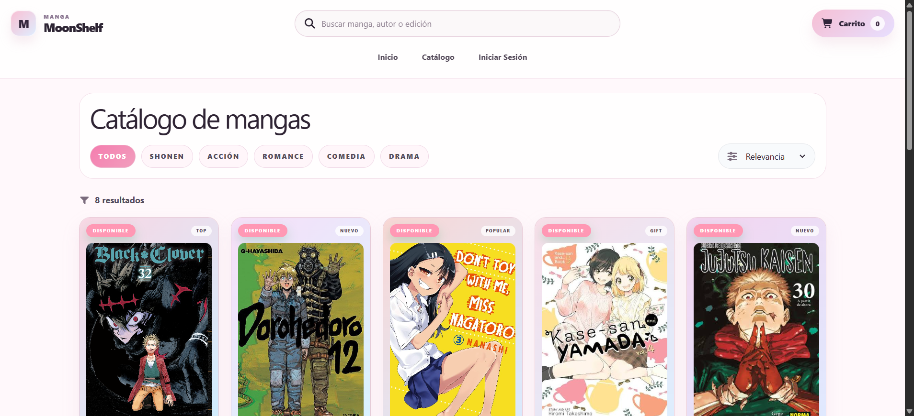
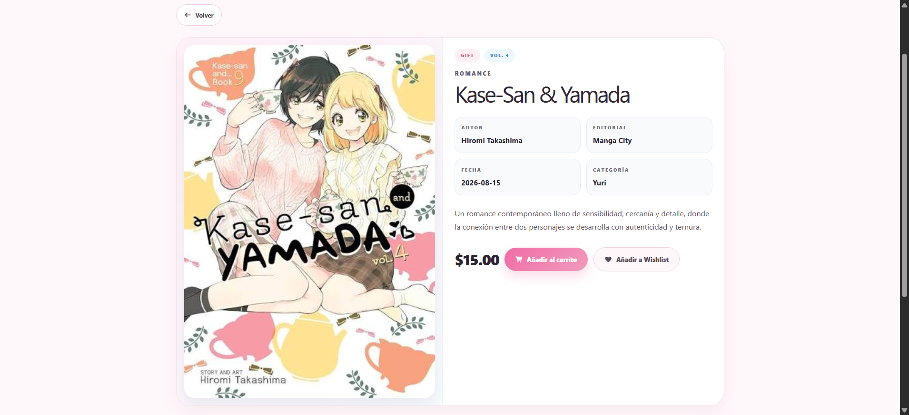
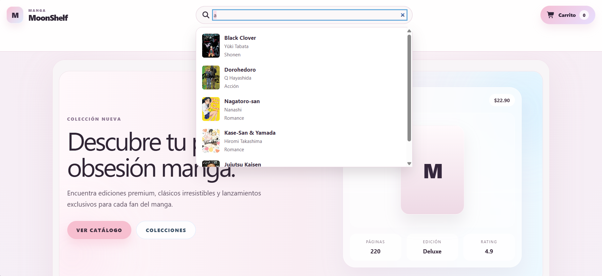

### Cart, Checkout y Ordenes de Compra

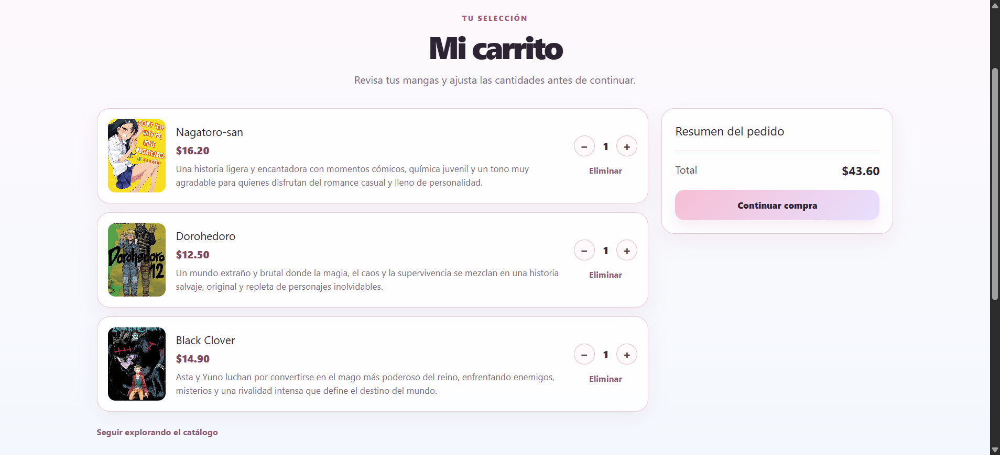
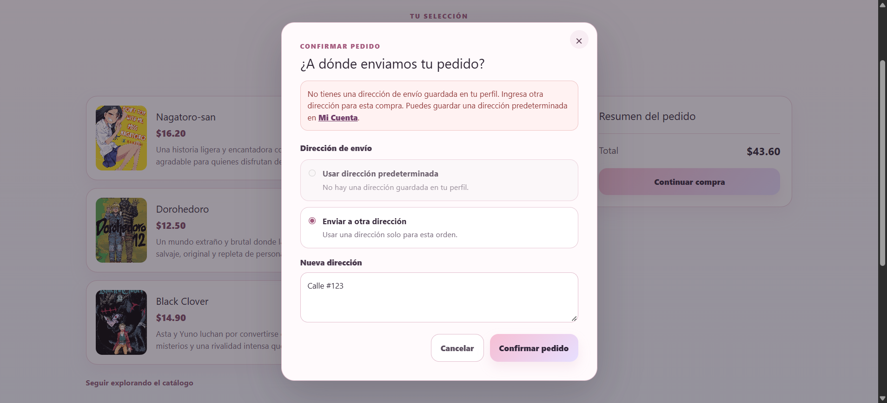
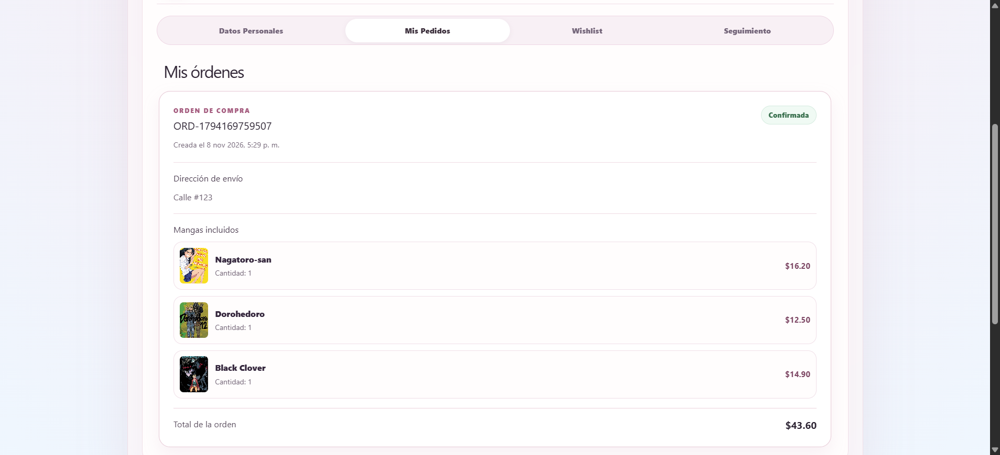
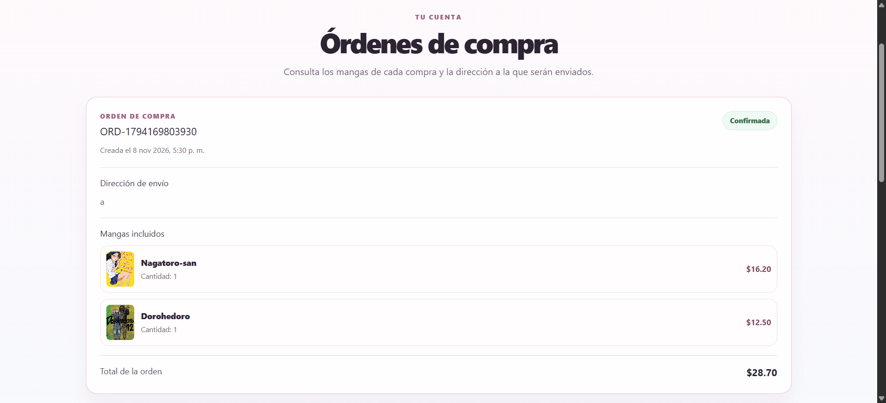

### Login, Register, Perfil y Wishlist

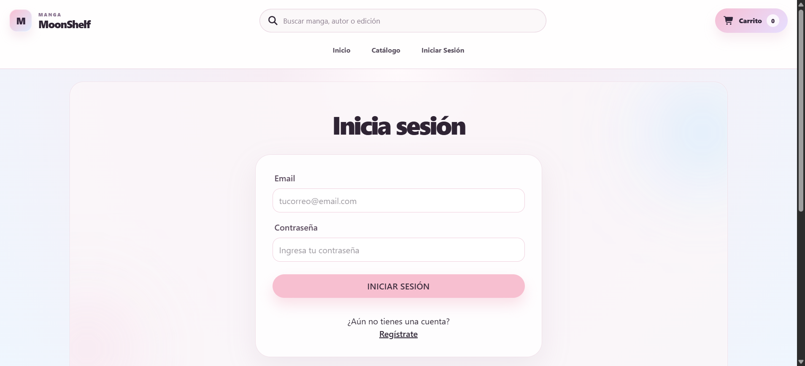
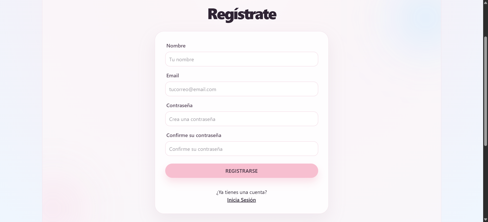
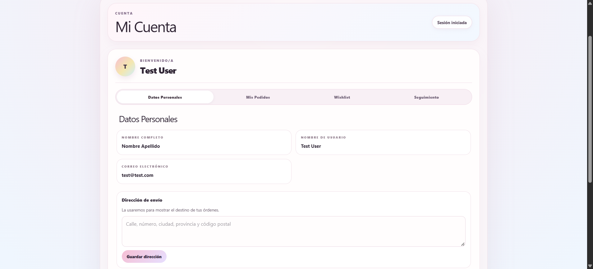
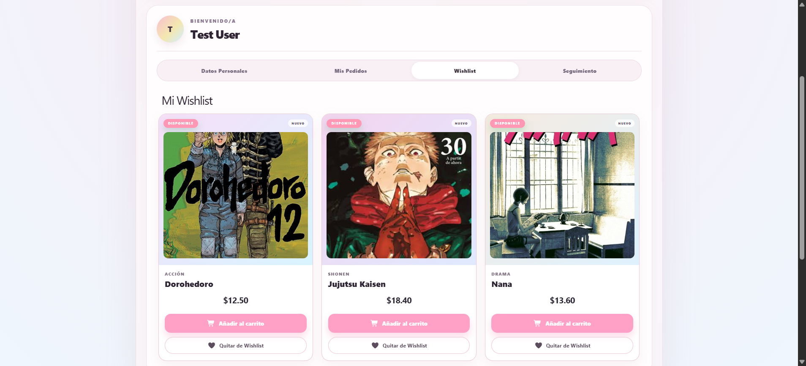 -->

## Tecnologías y dependencias

| Backend           | Frontend     | 
| ----------------- | ------------ | 
| Node.js           | React + Vite | 
| Express           | React Router | 
| PostgreSQL (`pg`) | Tailwind CSS | 
| JWT               | Axios        | 
| Argon2            | Zod          | 
| Zod               | JWT Decode   | 
| CORS              | Font Awesome | 
| Helmet            | Vitest       | 
| DotEnv            |              | 
| Winston           |              | 
| Morgan            |              | 
| Jest              |              | 
| Supertest         |              | 

## Requisitos

Tener instalada la versión más reciente de los siguientes programas:

- Node.js
- npm
- PostgreSQL

## Instalación y ejecución

### Descarga del proyecto e instalación de dependencias

1. Clona este repositorio a tu ordenador con ssh, https, o hazle fork y descarga tu copia, así también puedes colaborar con nosotros enviandonos una pull request.

2. Instala las dependencias de cada aplicación desde su propio directorio, para las del backend:

    ```bash
    cd backend
    npm install
    ```

    En otra terminal, instala las del frontend:

    ```bash
    cd frontend
    npm install
    ```

### PostgreSQL

Usaremos `postgres` como usuario para configurar la base de datos, deberás ingresar su contraseña. También puedes usar otro usuario si así lo prefieres. Para esta sección, abre una terminal en la raíz del proyecto y sigue los pasos a continuación.

3. Crea la base de datos:

    ```PowerShell
    createdb -U postgres moonshelf
    ```

4. Crea las relaciones de la base de datos ejecutando [`schema.sql`](./backend/src/database/schema.sql):

    ```PowerShell
    psql -U postgres -d moonshelf -v ON_ERROR_STOP=1 -1 -f ./backend/src/database/schema.sql
    ```

5. Inserta datos de prueba a la base de datos ejecutando [`mock-data.sql`](./backend/src/database/mock-data.sql):

    ```PowerShell
    psql -U postgres -d moonshelf -v ON_ERROR_STOP=1 -1 -f ./backend/src/database/mock-data.sql
    ```

    > - Puedes ver ejemplos de inserción en [`insertion-example.sql`](./backend/src/database/insertion-example.sql)
    > - También puedes usar ejemplos de selección en [`select-utilities.sql`](./backend/src/database/select-utilities.sql)
    > - Se utiliza `SET client_encoding = 'UTF8';` al inicio de cada script para normalizar el formato de los datos insertados desde de la terminal de manera simple.
    > - Recuerda que ejecutar [`schema.sql`](./backend/src/database/schema.sql) reinicia las relaciones, deberías ejecutarlo una única vez y repetir su ejecución solo para limpieza, no lo hagas si quieres persistir datos ingresados posteriormente.

### Backend

6. Crea `backend/.env` con la configuración correspondiente a tu entorno:

    ```env
    NODE_ENV=development
    PORT=5000

    FRONTEND_URL=http://localhost:5173

    JWT_SECRET=reemplaza-por-un-secreto-local

    PGHOST=localhost
    PGPORT=5432
    PGDATABASE=moonshelf
    PGUSER=postgres
    PGPASSWORD=postgres
    ```

    > Recomendamos crear un usuario dedicado (ejemplo: moonshelf) con una contraseña segura y con los permisos mínimos necesarios solo para a esta base de datos y sus tablas, tanto en desarrollo como en producción, así disminuyes las brechas de seguridad.

7. Inicia el servidor desde `backend/`:

    ```bash
    npm run dev
    ```

    > La API estará disponible en `http://localhost:5000`. Puedes comprobar su estado en `http://localhost:5000/`.

### Frontend

8. Crea `frontend/.env` y configura la URL de la API:

    ```env
    VITE_API_URL=http://localhost:5000
    ```

9. Inicia Vite desde `frontend/`:

    ```bash
    npm run dev
    ```

    > Vite mostrará en la terminal la dirección local de la aplicación, por defecto `http://localhost:5173`.

    - Estas instrucciones son para que utilices la aplicación en modo desarrollo. Si deseas desplegarla a producción, recuerda utilizar plataformas de despliegue en la nube como Render, Vercel, Supabase, etc.
    - En ese caso deberás configurar correctamente los secretos que indican las URLs tanto del cliente como del servidor y la base de datos.
    - Si realizas despliegues locales para uso personal, haz un build de la aplicación frontend. Utilizarla en modo desarrollo utilizará dependencias de desarrollo y no optimizará la aplicación para su funcionamiento en producción.

## Pruebas y validaciones

1. Para ejecutar las pruebas del backend:

    ```bash
    cd backend
    npm test
    ```

2. Para compilar y revisar el frontend:

    ```bash
    cd frontend
    npm run build
    npm run lint
    ```

## Documentación del proyecto

- [Diseño de la base de datos](./docs/database-schema.jpg)
- [Contrato de datos de la API](./docs/data-contract.md)
- [Diseño de interfaz](./docs/1_Diseño_Interfaz_Gráfica.pdf)
- [Navegación y vistas](./docs/2_Navegación%20_Vistas.png)
- [Listado de dependencias](./docs/3_Listado_Dependencias.md)

## Estado de la Licencia

Proyecto académico en desarrollo. No se ha definido una licencia para el repositorio.
